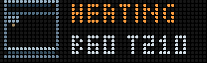
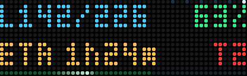
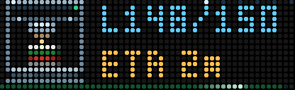
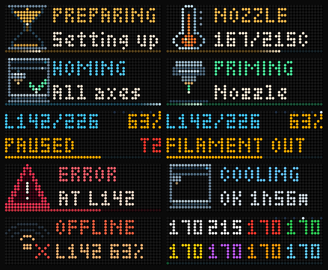

# Klipper Dashboard for AWTRIX NG (Ulanzi TC002)

**[Install from the AWTRIX Hub](https://awtrix.de/script/XyFadk4KssPL)** · [Releases](https://github.com/isewise/Klipper-TC002-Script/releases) · [Changelog](CHANGELOG.md)

Keeps an eye on your Klipper printer for you. Glance at the clock and you
see what the printer is doing before the first layer – heating, homing, the
bed mesh filling in point by point – then the layer, an ETA you can trust,
and every head's temperature. When the print is done, fireworks go off in
your filament's colours. It is built for multi-head printers (tool changers,
IDEX, Snapmaker U1, 8- and 9-head machines) and is just as at home on a
single-head Ender.


## What it shows

- **While printing:** layer and percentage, ETA and finish time, the active
  head's and bed temperatures, every head's temperature on multi-head
  printers, the file name, the active tool's material and filament use.
- **Before the first layer:** what the printer is doing – heating, homing,
  gantry levelling, bed mesh (with a live map of the probe points), heat
  soak, priming – instead of a 0% bar.
- **Alerts** (each optional): print finished (on by default, with fireworks
  in the print's filament colours), failed, paused or out of filament,
  progress milestones (first layer, 50%, 90%), tool changes, printer lost
  mid-print. Three sound levels: off, failures only, or all.
- **After a print:** a finish screen with the print time for 10 minutes.
- **Between prints** (optional): printer state, temperatures and the last
  job – or why Klipper is not ready (printer off, shutdown, error).

| | |
|---|---|
|  |  |
| Before the first layer – recorded from a real Ender 3 with a BLTouch and KAMP | While printing – the pages take turns |
|  |  |
| Print finished | A progress alert |



Accuracy notes:

- Progress and ETA use your slicer's time-based progress (`M73`) when the
  file has it – OrcaSlicer and its forks, PrusaSlicer and Bambu Studio write
  it by default. Otherwise progress comes from the G-code's position in the
  file, excluding thumbnails and the settings block.
- Layer numbers come from the slicer when its printer profile sends them to
  Klipper (`SET_PRINT_STATS_INFO`). Many profiles do not – OrcaSlicer's stock
  Creality profiles, for one – and then, like Mainsail and Fluidd, the
  script works the layer out from the nozzle height and the file's layer
  height.
- Filament colours and materials come from the slicer, or from the printer
  itself when it reports what is loaded (Snapmaker U1, AFC, Happy Hare).

## Requirements

- Ulanzi TC002 running AWTRIX NG.
- A Klipper printer with Moonraker reachable from the clock on your network.
  The clock only reads from Moonraker; it never sends commands.

## Setup

1. Install the script from the [AWTRIX Hub](https://awtrix.de/script/XyFadk4KssPL), or import `KlipperDashboard.ax`
   from this repository on the **Scripts** tab of the AWTRIX web UI.
2. Open **Apps**, press the gear button on **Klipper Dashboard**, and enter
   your printer's **IP address**. The clock cannot look up names such as
   `voron.local`, so give the printer a fixed address in your router (a DHCP
   reservation). Port **7125** is Moonraker's own port; **80** also works
   when Mainsail or Fluidd serves your printer.
3. Start a print. The app joins the rotation when a print starts and leaves
   it afterwards (or stays, with **Show when idle**).

To see every screen without printing, turn on **Preview without printing**
and pick a **Preview state**. Press select to test that state's alert.

## Settings

| Group | Settings |
|---|---|
| Connection | Printer IP address, port, refresh interval, idle refresh interval |
| Display | Look (minimal / standard / expressive – the default, with a drawing for each step), progress colour, seconds per page, material page, show when idle, tool labels (T0… or H1…), filament units |
| Progress | Show preparation stages, ETA calculation |
| Alerts | Print finished, failed, paused or filament out, progress alerts, tool changes, printer lost mid-print, alert sounds |
| Advanced | Debug logging, preview |

A few rarely changed values – custom alert sounds (a sound stored on the
clock or RTTTL text), glow, filament density, how long the finish and
"offline" screens stay – are in the **ADVANCED OPTIONS** block at the top
of `init()` in the script. Note: AWTRIX does not offer Hub updates for a
script you have edited.

## Printer support

| Printer / feature | Status |
|---|---|
| Any Klipper + Moonraker printer | Supported |
| Multi-head: tool changers, IDEX, up to 16 heads | Supported |
| Snapmaker U1 (tested with the paxx12 Extended Firmware) | Supported, including its preparation steps, heat-soak countdown and loaded filaments |
| Gantry levelling (Voron QGL, Z-tilt) | Supported |
| Probes reporting each point (BLTouch, inductive, Klicky…), old and new Klipper output | Supported, with a live map of the mesh |
| KAMP adaptive mesh and line purge | Supported (tested on a Klipper Ender 3 with BLTouch) |
| Slicers without layer information | Supported (preparation is detected from Klipper itself) |
| AFC (Box Turtle and others), Happy Hare | Draft – feedback wanted |

## Troubleshooting

The script writes `[KD]` lines to the clock's **Log** tab when something is
wrong. Each line appears once, when the connection changes.

**"No answer from http://…"** – the clock cannot reach Moonraker. Check the
address and port, that the printer is on, and that it is on the same network
as the clock. Use the IP address: the clock cannot look up names such as
`mainsailos.local` (it then also logs "The clock cannot look up printer
names").

**"Moonraker refused access (HTTP 401)" or 403** – your Moonraker requires
a login (API key) for this clock. The script cannot use API keys, because the
TC002 only sends keys to addresses fixed in the script. Instead, let Moonraker
trust the clock: in `moonraker.conf`, add the clock's address – or your whole
network – to `trusted_clients`, then restart Moonraker:

```ini
[authorization]
trusted_clients:
    192.168.1.0/24
```

Most Moonraker installs (MainsailOS, KIAUH, stock Snapmaker U1 firmware)
already trust the local network, so this only matters if you turned on
forced logins.

**"Klipper shutdown: Lost communication with MCU"** (the idle screen shows
**SHUTDOWN / NO MCU**) – the computer running Moonraker is on, but the
printer's board is switched off or unplugged. Power the printer on; if
Klipper does not reconnect by itself, run `FIRMWARE_RESTART` from Mainsail
or Fluidd. While Klipper is down the clock shows no temperatures, because
Klipper's last readings stay frozen. A print that was running when Klipper
stopped counts as failed. Other "Klipper shutdown" or "Klipper error" lines
quote Klipper's own reason.

**"Moonraker answers, but the Klipper service is not running"** (screen:
**STOPPED**) – restart Klipper, for example from Mainsail's power menu.

**Preparation shows "PREPARING / Setting up" with an hourglass** – your printer does not report
what it is doing at that moment (no status messages, no probe output).
Heating, homing, levelling and probing are still detected on every printer.

**The finish time looks hours off** – set the clock's time zone in the
AWTRIX web UI.

## Help improve support for your printer

A **recording** of one print from your printer lets us replay it on a test
clock until the dashboard gets it right. Recordings of printers we have not
tested – especially AFC, Happy Hare and stock-firmware Snapmaker U1 – help a
lot. **[How to make and send a recording](docs/RECORDING.md)** – one download,
one command, and it only reads from your printer.

`tools/mock_moonraker.py` simulates printers for testing (`--help` lists the
profiles), and `tools/replay_moonraker.py` plays a recording back.
`tools/make_media.py` films the pictures on this page from the AWTRIX NG
emulator, and `tools/gif.py` records any AWTRIX display as an animated GIF.
[`tests/`](tests/README.md) runs the script on the AWTRIX NG emulator against
both, including recorded prints from a Snapmaker U1 and a Klipper Ender 3.

## Versions

What changed in each version: [CHANGELOG.md](CHANGELOG.md). Every version
is also a [GitHub release](https://github.com/isewise/Klipper-TC002-Script/releases)
with the script attached. How a release is made: [docs/RELEASING.md](docs/RELEASING.md).

## License

MIT – see [LICENSE](LICENSE). Use, change and share it freely; keep the
copyright notice.
